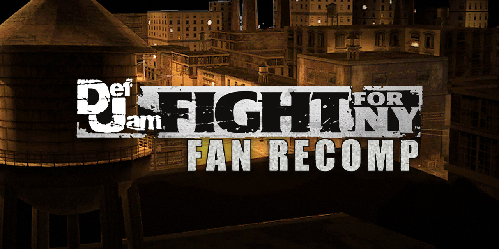
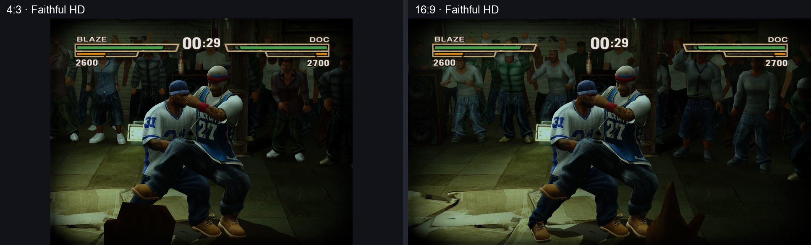
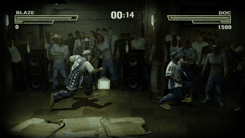
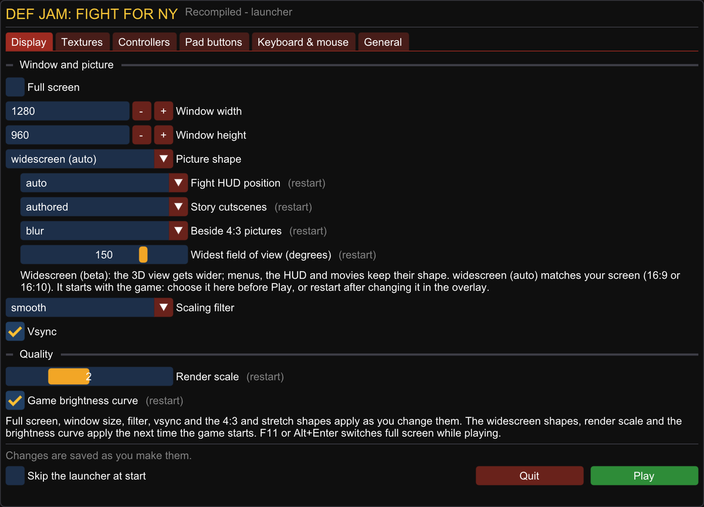

# Def Jam: Fight for NY — Recompiled

Bring **Def Jam: Fight for NY** to Windows, macOS and Linux, including the Steam Deck.
This unofficial native port recompiles the original Xbox game for your computer,
with higher rendering resolution, modern controller support, local multiplayer
and optional HD textures.

**The port is now mature and continues to improve.** All game functionality is working and we are continuously optimizing, enhancing, and bugfixing. See
[known issues](docs/known-issues.md) and the
[latest release notes](https://github.com/vyanhursky/DefJamFFNY-recomp/releases/latest)
for current limitations.

You need **your own supported USA Xbox dump**. Setup checks your dump and builds
the game on your machine. PS2 and GameCube copies cannot be used.

**[Get the latest setup](https://github.com/vyanhursky/DefJamFFNY-recomp/releases/latest)** ·
[Install guide](docs/setup-installer.md) · [Documentation](docs/README.md) ·
[Report a problem](https://github.com/vyanhursky/DefJamFFNY-recomp/issues/new/choose) ·
[Join the Discord](https://discord.gg/xNvBs23ZBw)

**[v0.12.1 — Created fighters and widescreen fixes](https://github.com/vyanhursky/DefJamFFNY-recomp/releases/tag/v0.12.1)** is the latest stable release: created-fighter portraits, eye colours and thumbnails, the right-side meters, and widescreen placement of the paused HUD and the menu song notification. [v0.12.0](https://github.com/vyanhursky/DefJamFFNY-recomp/releases/tag/v0.12.0) rebased the toolkit onto xboxrecomp v0.16, with audio fixes and steadier frames on variable-refresh Windows displays and the Steam Deck. [v0.11.0](https://github.com/vyanhursky/DefJamFFNY-recomp/releases/tag/v0.11.0) brought Mod Support Beta. Discover, download, enable and order mods in the launcher. HD Widescreen Menus is available in the default catalogue after refresh. See the release notes for known visual limitations.

## Gameplay

**4:3 versus 16:9 widescreen:** the same fight moment, with faithful HD textures
and native macOS rendering at 2× scale. The wider view reveals more of the arena
while keeping the fighters and HUD in proportion.

Silent three-second preview exported at 20 fps; its cadence is not a game
performance measurement. [Download the longer 60-fps MP4](docs/media/hd-16x9-gameplay.mp4).

**[Compare 4:3 and widescreen, original and HD textures, and see the launcher and overlay](docs/media/README.md)**

## Launcher

**Improved Game Launcher (v0.10.6)** brings a focused Home screen, with detailed options in
[Advanced settings](docs/launcher-and-overlay.md). The brickwork and torn-paper
style uses the game's charcoal, ivory, red and gold palette.
[Get the latest setup](https://github.com/vyanhursky/DefJamFFNY-recomp/releases/tag/v0.12.1).

## Features

- **Native across three platforms.** Windows x64 uses Direct3D 11; Apple Silicon
  Macs and x86-64 Linux use Vulkan. Steam Deck runs the Linux version natively.
- **60-fps gameplay.** The port targets 60 frames per second, with performance
  depending on your hardware, chosen settings and the scene.
- **Sharper rendering.** Choose 1×–4× internal resolution, a resizable window
  or borderless full screen.
- **Widescreen (beta), available now.** Since v0.9.0, Windows, macOS and
  Linux/Steam Deck support wider 16:9 and 16:10 views. The 3D view widens while
  the HUD and menus keep their shape; original 4:3 remains available.
- **Optional HD textures.** Setup can generate faithful 4× texture packs locally
  from your dump on Windows, macOS and Linux. Original textures remain available.
- **Controllers and keyboard play.** Xbox, DualSense, Switch Pro and other
  supported gamepads, with remapping, hot-plug and rumble. Keyboard and mouse
  buttons can supply gameplay bindings; the launcher and settings support a pointer.
- **Up to four local players.** Play with gamepads and a keyboard player.
  Network multiplayer is not supported.
- **Settings before and during play.** The launcher has a focused Home screen,
  Advanced settings and direct Mods/files/logs/setup actions. Open the in-game overlay
  with F1 or a configured controller shortcut. Changes are saved locally;
  settings that require a restart are marked. The overlay does not pause the game.
- **Optional faster startup.** Skip the legal screen and startup movies to reach
  Press Start after initial loading. Enable it under Interface;
  Story and attract-mode movies still play.
- **EA's developer menu, restored.** The game's own debug menu, cut off in the retail
  build, opens from the overlay (Diagnostics tab): set up any match with any fighters, venue and
  match type, play any Story scene, or look at a venue in the stage viewer. See
  [The developer menu](docs/developer-menu.md).
- **Local saves.** Profiles, settings and generated texture packs live in your
  data folder, which setup preserves through updates and repairs.

## Get started

1. Have your own USA Xbox disc image or extracted dump matching the
   [supported dump manifest](config/dump-manifest.json).
2. Download the setup for your platform from the
   [latest release](https://github.com/vyanhursky/DefJamFFNY-recomp/releases/latest).
3. Choose your dump, install folder and data folder. Enable HD texture generation
   if you want it, then let setup verify, recompile and build the game.
4. Open the launcher, choose your display and input settings, and select **Play**.

| Platform | Setup download | Guide |
|---|---|---|
| Windows x64 | `DefJamSetup-<version>-windows-x64.exe` | [Windows setup](docs/setup-installer.md) |
| macOS, Apple Silicon | `DefJamSetup-<version>-macos-arm64.dmg` | [macOS setup](docs/setup-installer.md#macos-setup-apple-silicon) |
| Linux x86-64 / Steam Deck | `DefJamSetup-<version>-linux-x64.tar.gz` | [Linux setup](docs/setup-installer.md#linux-setup) |

Setup builds from your dump rather than downloading a precompiled game.
The [install guide](docs/setup-installer.md) covers platform requirements,
unsigned-app prompts, disk space, updates and repairs. HD generation needs
additional disk space and install time.

Prefer a manual source build? Use [Build and play](docs/build-and-play.md) for
Windows or [Build on macOS and Linux](docs/build-macos-linux.md).

## Customize your game

Use the launcher or F1 overlay to change display settings, controls and texture
packs. The same options are stored in `settings.ini` in your data folder.

- [Launcher and overlay](docs/launcher-and-overlay.md)
- [Controllers, keyboard and mouse](docs/10-input.md)
- [Settings reference](docs/settings-reference.md)
- [HD texture packs: generate, install and enable](docs/hd-textures.md)

### Texture packs and mod support

**Available now:** local texture replacement packs, including the faithful HD
packs generated by setup. Packs can be enabled and ordered through the Mods
page. The [texture guide](docs/hd-textures.md) describes formats, load order and
supported resources.

**Proposed:** broader data overrides and a curated mod list managed from the
launcher, with downloads and updates handled by a separate helper. This is an
[unscheduled design proposal](https://github.com/vyanhursky/DefJamFFNY-recomp/pull/17).
New fighters, stages, music replacements and code/gameplay mods are not released
modding capabilities.

## Where the project is heading

The project aims to preserve the original game's experience while making it
easier to play and customize on modern computers.

| Direction | Goal and current stage |
|---|---|
| Engine optimizations | Improve performance on low-spec machines, stay up to date with [xboxrecomp](https://github.com/sp00nznet/xboxrecomp), and contribute improvements upstream. |
| Port accuracy | Keep the visuals, tone and gameplay feel faithful to the original Xbox game. |
| Fully unlocked frame rates | Support frame rates above 60 fps while preserving game speed, timing and gameplay feel. Future work; not supported by the current release. |
| Widescreen refinement | Beta released in [v0.9.0](https://github.com/vyanhursky/DefJamFFNY-recomp/releases/tag/v0.9.0) on Windows, macOS and Linux/Steam Deck. Improve edge cases and broader aspect/venue coverage; 21:9 and 32:9 remain experimental. |
| Broader mod support | Enable modified game modes, difficulty changes and restored cut content. The [mod-system design proposal](https://github.com/vyanhursky/DefJamFFNY-recomp/pull/17) is not scheduled; texture packs work today. |
| Build and release automation | Improve automation and the gameplay test harness so shipping builds have reliable, repeatable validation. |
| Deeper gameplay decompilation | Long-term stretch goal. |

These stages describe current work, not promised release dates. See the
[PC features plan](docs/07-m6-plan.md), [roadmap](docs/01-plan-review.md#corrected-roadmap-milestones-with-exit-criteria)
and [improvement backlog](docs/04-improvement-backlog.md) for detail.

## Compatibility and known limits

The released build targets Windows x64, Apple Silicon macOS and x86-64 Linux.
Steam Deck has automated regression coverage and maintainer playtesting;
Proton is untested. Performance varies with hardware, settings and scenes.
Steam Deck audio distortion and Story tutorial performance remain under
investigation.

Check both [known issues](docs/known-issues.md) and the
[latest release notes](https://github.com/vyanhursky/DefJamFFNY-recomp/releases/latest).
Some release-specific fixes and validation limits appear in the notes first.

## Community

This project is in very active development, and the
**[Def Jam: Fight for NY Recomp Discord](https://discord.gg/xNvBs23ZBw)** is where
we collaborate and talk it through. Join to:

- follow and discuss development as it happens;
- share player feedback and ask for help getting set up;
- suggest enhancements and ideas for the port;
- talk about mods and texture packs.

Discord is for conversation. Please still file bugs as
[GitHub issues](https://github.com/vyanhursky/DefJamFFNY-recomp/issues/new/choose)
so they are tracked, and never share game files or dumps there either.

## Help improve the port

[Report a problem](https://github.com/vyanhursky/DefJamFFNY-recomp/issues/new/choose)
with your version, operating system, CPU/GPU, controller, reproduction steps and
relevant log lines. Remove personal paths and keep game files, saves and memory
dumps out of reports. With the [play-test recorder](docs/playtest-recorder.md) on, F9 (or
View + left stick click) saves the last seconds of play as a bug bundle to attach. See [Contributing](CONTRIBUTING.md) for reporting guidance,
development setup and the tests a change needs.

Bug fixes, platform testing and documentation improvements are welcome.
The [gameplay test harness](docs/09-testing-harness.md) explains automated game
checks and their limits. GitHub CI also runs checks that need no game data;
a passing CI badge does not establish full campaign compatibility.

## How it works

The [xboxrecomp](https://github.com/sp00nznet/xboxrecomp) toolchain translates the
Xbox executable into C, which is compiled ahead of time. The game's code runs
through an Xbox compatibility runtime, with graphics, audio and input supplied
by your computer. This is a static recompilation port; deeper gameplay
decompilation remains future work.

The repository distributes maintained port code, build tools and documentation.
It does not distribute a disc image, playable game data, translated game source
or a compiled game executable. The repository does include selected approved
screenshots and branding artwork; those retain their original ownership.

## Credits and licensing

Maintained by **vyanhursky**, with development assistance from Claude Code and
Codex. Built on **sp00nz's xboxrecomp** and work from the Xbox emulation
community, including xemu hardware references and attributed toolkit components.
[Burnout 3](https://github.com/sp00nznet/burnout3) and
[Mercenaries Recompiled](https://github.com/KraftMacAndChee/Mercenaries-Recompiled)
are related projects that helped shape the documentation.

The project's code is [MIT licensed](LICENSE). Toolkit components retain their
own licenses; see the [toolkit NOTICE](https://github.com/vyanhursky/xboxrecomp/blob/4bff2573127c5499ad795d58ddd90159240520bd/NOTICE)
and [license texts](https://github.com/vyanhursky/xboxrecomp/tree/4bff2573127c5499ad795d58ddd90159240520bd/LICENSES).
The license grants no rights to the game or its artwork.

This is an unofficial fan project, not affiliated with Electronic Arts, AKI or
Def Jam. Def Jam: Fight for NY and its assets belong to their respective owners.
