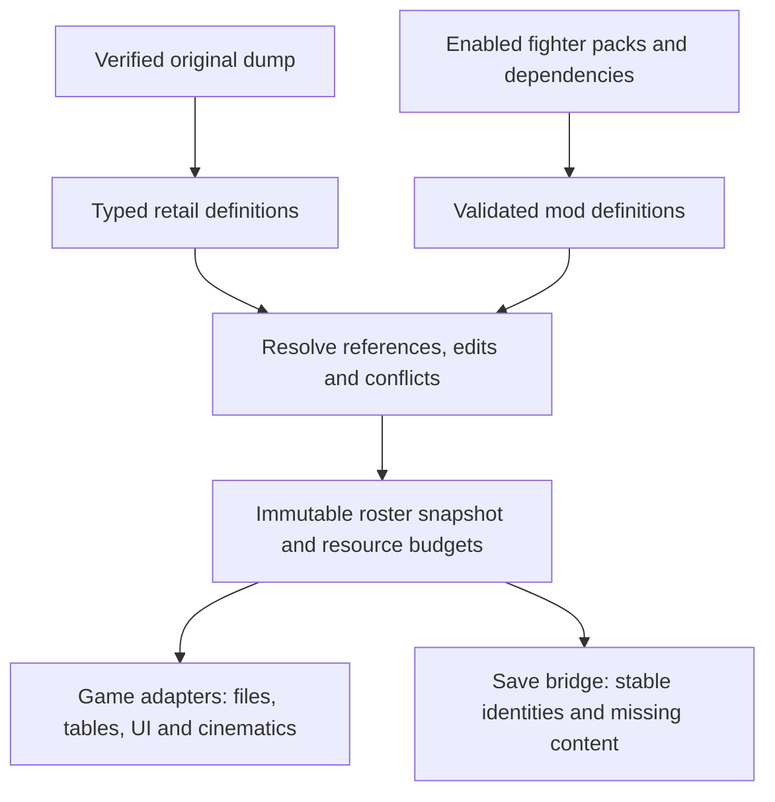

# Fighter Mod Support — approved implementation plan

**Target: v0.15.0. Status: approved architecture; local implementation underway.**
No public branch push or public PR. This revision follows
the owner's request to build the maintainable system first. It supersedes the
proposal to ship a Vendetta-specific compatibility bundle. Owner decisions are
recorded below; evidence-dependent implementation details remain
explicit rather than being treated as approvals.

## Delivery milestones (M1–M3 authorized)

These are Fighter Mod Support milestones, distinct from the project's original
M0–M8 port roadmap. The owner authorized implementation and computer testing of
M1/M2 on 2026-11-04, including bounded independent audits, and continued M3
on 2026-11-06 after the M1/M2 handoff. Keep native runs serial and all work
local; do not count structural parsing as native acceptance.

| Milestone | Deliverable and acceptance |
|---|---|
| M1 — New fighter appearance | Validated models, skeletons, skinning, materials and textures, with general resource loading and basic cleanup. Custom 2D portraits stay in the native selector; genuinely new 3D geometry must appear in entrances and combat, move, attack and receive hits through ordinary resource definitions. Compatible retail animations may be reused initially. Test a second independent pack early. |
| M2 — New fighter behavior | Native adapters for movesets, motion/event links, voices, AI, intros, victories and Blazin sequences, with separately documented resource capacities. Two independent packs must coexist correctly as humans and CPUs, including four participants; inherited retail behavior and genuinely added behavior must both be tested. |
| M3 — Lifecycle and save reliability | Repeated matches, bounded resource ownership, disconnect/rejoin, pack update/removal/missing content, interrupted native writes, and Story/created-fighter interactions. Preserve stable identities, complete saves and progression under stress and failure. |
| M4 — Launcher integration | Fighters category; whole-pack install, activation, update, rollback, restart and profile workflow. Failed operations preserve the working configuration and produce actionable errors. |
| M5 — Creator tools and Vendetta conversion | Inspect, convert, validate, package and authoring documentation. Ordinary-format Vendetta conversion; any remaining technical blocker is reviewed before declaring completion. |
| M6 — Release acceptance | Windows/macOS/Steam Deck acceptance, stock regressions, performance/resource soaks and owner playtest. |

Documentation and focused regression tests accompany each milestone. M1's
first model should receive cross-platform smoke checks where test machines are
available; complete platform release acceptance remains M6. Consequential rig,
capacity or save tradeoffs return to the owner; routine implementation choices
remain within the approved hybrid architecture. M1's Windows implementation
and local acceptance are complete with the owner's 2D-selector decision;
macOS/Deck smoke checks have not been performed. Independent Blazin cache
ownership now has positive human/CPU playback evidence. M2's corrected
end-to-end paired-finisher/results test and stock quick regression pass.
The human-initiated finisher has positive playback evidence for both roles.
M1/M2 implementation is handed off locally with the qualifications in the
checkpoint: the owner waived another routine stock regression and requested
handoff after that proof. The focused test was closed normally and its complete
save tree restored byte-identically; it is not a completed full-match pass.
The earlier full-match and stock passes remain the acceptance evidence.
The owner authorized continuing M3 here on 2026-11-06. Its implementation and
focused Windows acceptance are complete locally, using native profiles plus a
versioned extension. Crash recovery, pack removal/update/re-enable, zero-pack
saving, native profile deletion, repeated-match ownership, controller rejoin,
ready/cancel and signed-in custom-player/Story reload checks are documented in
[M3 lifecycle and save reliability](research/fighter-mod-m3-2026-11-06.md).
M4 launcher/normal-profile adoption and M6 platform/long-run release acceptance
remain gated; no public push or PR has been made.

## Direction already agreed

- Feature: **Fighter Mod Support**. Launcher category: **Fighters**.
- A pack defines **one fighter or many fighters**. Several independent packs must
  coexist. Single/multiple fighters use the same pipeline, with shared resources
  and explicit references between definitions.
- Preserve retail fighters and Story behavior. Additions and explicit overrides
  of existing fighter components are separate operations.
- Packages supply validated data/assets. Executable behavior belongs to the
  recomp; no mod-provided native hooks, arbitrary memory patches or edits to
  generated game code.
- Adding/updating/disabling/removing packs must preserve profiles and progression.
  Missing content remains recoverable; saved identities never become other fighters.
- Vendetta is an eventual real-world conversion/acceptance case. It does not set
  our schema, IDs, limits, database layout or save policy. Any converter must emit
  the ordinary format and pass the ordinary validator. No exclusive legacy mode
  or hash-specific runtime branch.
- Keep R&D local and preserve independence from the reference implementation.

## Proposed system

A fighter is a typed definition with stable identity and references to appearance,
behavior and presentation resources. Several fighters can share movesets, voices
or asset libraries; these counts do not necessarily grow together. Extract the
retail definitions locally into the same internal representation. Do not ship
another copy of the game's databases.

The **registry** describes fighters/resources. The **resolver** builds a consistent
roster. The **adapters** make the original game consume it safely. No relational
database server is required.

Keep package identity, stable fighter/resource keys, native selection IDs, native
moveset/core indices, voice IDs, SOD handles and participant slots distinct.
Persistent state uses stable keys; engine numbers are internal bindings. Each
binding is fixed for its declared lifetime. Match-scoped bindings can change only
at audited teardown/load boundaries. Restore must reconstruct or explicitly
migrate any native numbers retained by the save format.

Changes build a new validated snapshot and require restart. Failed validation
preserves working settings/files/saves and reports the problem; never silently
launch a different roster. Reuse manager receipts, locks and transactions. Cache
identity includes dump, schema/adapter version, resolved content and bindings.

## Architectural decisions and remaining review

| Decision | Owner direction |
|---|---|
| D1 — capacity | Approved: stable logical keys; select expansion/virtualization after audit, assess beyond 255 |
| D2 — data integration | Approved: hybrid, refine the native-cache/runtime-hook split through testing |
| D3 — saves | Approved: extend existing profiles if safe; otherwise isolated mod-enabled profiles |
| D4 — conflicts | Approved: compatible component composition; actionable errors for unresolved conflicts; a helper/tool where practical |
| D5 — activation | Approved: whole-pack activation |
| D6 — selection | Approved: native menus only; evaluate appended entries versus a per-player custom-roster page |

Alternative designs are retained below to explain the tradeoffs. Their presence
does not reopen the accepted choices.

### D1. Capacity: wider native indices or virtual engine slots?

**A — Expand native indices/tables.** Give the game a consistently larger roster.
Audit/adapt every narrow selection, runtime and persistence boundary. Relocating
arrays can be straightforward; widening struct fields may affect many embedded
offsets and readers.

**B — Map a large logical roster into bounded native slots.** Reuse existing
layouts where practical and bind selected content at a well-defined session or
match boundary. This avoids some structural changes but requires complete control
of cached IDs, previews, voice banks, cinematics and resource lifetime. Four active
fighters does not prove that four reusable slots suffice.

**Owner-approved direction:** stable logical keys and a width-independent package schema
now; choose expansion/virtualization **after the capacity audit**. Prefer direct
table expansion where sufficient; virtualize where narrow layouts make widening
much more invasive. A hybrid needs explicit invariants for each binding boundary.
Do not assume 255 is a product limit or promise unlimited fighters.

**Current evidence:** the front-end uses a signed byte, shared roster storage
has a separate fixed boundary, and Options has 80 unlock cells. The hybrid
prototype keeps historical logical IDs in native appended menus and binds four
participant rows for each match. A 300-custom-fighter roster selected logical361
and reached combat; a further four-participant match selected254/255/256/257
together with correct stable identities. This establishes a real path beyond255,
not an unlimited roster or completed capacity acceptance. Bank teardown/reuse,
independent controllers and other menus remain gates. See the
[active native evidence](research/fighter-mod-runtime-2026-11-02.md) and
[earlier capacity audit](research/fighter-mod-capacity-2026-11-01.md).

### D2. Integration: compile native data or register through runtime hooks?

**A — Assemble native data before launch.** Compile the resolved registry into
cached databases/archive members; redirect reads and grow tables as necessary.
Preserves more original loading behavior and supports offline inspection, but
requires serializers and potentially costly cold builds.

**B — Runtime registration hooks.** Intercept relevant lookup/load paths and
serve registry-owned records. Avoids some archive rebuilding, but makes us
responsible for layouts, ownership and direct/indirect call coverage.

**Owner-approved direction:** one typed resolver with a hybrid adapter: cache native data
where formats are understood; use narrow maintained runtime hooks for capacity,
identity and behavior files cannot express. Choose the exact split after the
consumer inventory. Compose language/fighter changes through one overlay plan
rather than independently generating conflicting copies of the same file. Refine
this split through tests; the owner agrees the best route is not yet fully known.

### D3. Saves: extend existing profiles or separate mod-enabled profiles?

**A — Retail profile plus versioned extension/sidecar.** Store custom identity,
progression, availability and bindings in companion state, keeping retail progress
usable. Requires intercepting every custom persistence path and coherent commit/
recovery of the related files. A sidecar alone cannot prevent unsafe retail writes.

**B — Isolated mod-enabled profiles.** Import/copy retail progress into a separate
namespace and preserve original files. Contains unknown native save-layout risks
and simplifies rollback, but players manage a separate progression history and
need explicit import/export rules.

**Owner decision:** use A if complete persistence isolation can be proven;
otherwise use B. The fallback is authorized: document the evidence requiring it,
preserve the original profile and make the separate progression/import behavior
clear. Both retain dormant stable records for missing fighters and block actions
needing unavailable content with a restore path. No silent substitution, lost
progression or sample-based repair.

### D4. Overrides: strict ownership or typed component composition?

**A — One owner per definition.** Conflicting edits need an explicit compatibility
patch. Simpler to explain/test, but rejects independent portrait and voice edits.

**B — Compose disjoint components.** Combine independent edits; conflicting claims
on a component require an explicit override/patch. More flexible, but skeleton/
model/animation and voice/event bundles need documented compatibility groups.

**Recommendation:** B with coarse compatibility groups and explicit overrides.
Validate the combined fighter. Texture priority must not silently resolve gameplay
conflicts. Resolve dependency/version constraints to an exact local content lock.

**Owner decision:** combine compatible components and return an actionable error
for unresolved conflicts. A compatibility helper/tool is desirable where practical,
but is not required to resolve every conflict automatically. The following
hypothetical cases illustrate the accepted direction, not existing runtime support:

| Enabled packs | Expected result under B | Why |
|---|---|---|
| One adds DMX; another adds Eminem, each with independent keys/assets | Both work | Different definitions merge into the generated native databases. Sharing an output database is not itself a conflict. |
| One replaces Blaze's portrait; another replaces his voice with compatible events | Combine after validation | These edit independent components. Whole-definition ownership would reject them unnecessarily. |
| Two packs change Blaze's health, one to 80 and another to 120 | Conflict | One effective fighter cannot have both values. Disable one conflicting pack or use a declared override/compatibility patch selecting the intended result. |
| One gives Blaze a different joint layout; another supplies animations for his original skeleton | Incompatible unless adapted | The files/components differ, but the combined fighter may deform or crash. Related components need group validation. |
| Two packs require incompatible versions of a shared moveset library | Dependency conflict unless safely separable | Their shared requirements may not be satisfiable together even when individual fighters are valid. |

Matching display names alone are not a conflict: independently keyed DMX variants
can coexist. Duplicate stable identities and incompatible resource claims matter.
Referencing a retail donor moveset does not edit the donor or other fighters using
it. An authored variation gets its own resource key unless a shared override is
explicitly intended.

The proposed player-facing rule is: independent additions combine; compatible
component edits combine; contradictory edits or invalid combinations explain the
conflict before launch. Automatic last-pack-wins is another option for simple
same-field overrides, but cannot repair incompatible skeletons/animations.
Existing texture-pack image priority remains separate from gameplay resolution.

### D5. Multi-fighter packs: whole-pack or individual fighter activation?

**A — Whole-pack activation.** Install/update/enable atomically; simpler dependency
and settings behavior and fewer accidental partial configurations.

**B — Individual activation.** Players choose fighters inside a pack. Shared
resources and cross-fighter references need dependency closure; disabling one
fighter needs the same save policy as disabling its pack.

**Owner decision:** A, whole-pack activation. Retain independent fighter keys
internally. Merely hiding a roster entry with a display filter or switching the
visible selection page is different from disabling its definition/resources.

### D6. Selection UI: extend the game's interface or use a host browser?

**A — Extend native selection movies.** Keep the original visual/controller flow,
with pagination/filtering and generated portrait registration. Requires a reusable
UI authoring/bounds solution; packs must not replace whole selection movies.

**B — Host-rendered roster browser.** Scales search/filtering more naturally and
passes validated selections into native match setup. Changes presentation and
requires integration with every relevant mode. A launcher-only picker is not
enough for in-game selection flows.

**Owner decision:** A. Keep all fighter selection in the native menus; a
host-rendered roster browser is not planned. Preserve the retail roster's order
and menu behavior. Evaluate these two native presentation patterns:

- **Appended roster:** custom fighters appear after the retail list. Verify
  scrolling, wraparound, pagination, indexing and portrait/movie limits as it grows.
- **Per-player roster switch:** an unused, clearly labelled button/controller
  action switches the browsing player's native selector between retail and
  custom fighter lists, using the same visual layout. Player 1/2/3/4 each keep
  their own page, cursor and selection state. Switching one player's page must
  not change another player's highlighted/selected fighter or ready state.

The page switch is a browsing action, not mod activation or a game-wide roster
swap. Its implementation must retain stable fighter identity across pages and
validate native movie/state ownership before assuming selectors are independent.
Choose the button only after auditing existing controls and label it in the
native interface. Back/cancel/ready, CPU selection, portraits/previews, created
fighters and all native menu variants must continue to work. Prototype both
patterns within the native menu to choose the one that scales without breakage;
the owner raised the page switch as an idea, not a final binding/layout choice.

Routine syntax choices should follow project conventions rather than become
owner decision overhead. A strict versioned JSON-like manifest is a reasonable
starting point; it contains logical references, never engine addresses.

## Package and authoring contract

This is a checklist, not a frozen schema or supported export command.
The [local authoring prototype](fighter-mod-authoring.md) documents executable
definition/conflict checks without advertising installable fighter packages.
The [native adapter checkpoint](research/fighter-mod-native-adapter-2026-11-02.md)
records the connected retail-export/resolver/cache pipeline and current limits.

- **Package:** stable ID/version, authors/provenance, category, runtime/capabilities,
  dependencies/version constraints, conflicts and content hashes.
- **Definitions:** independently keyed fighters and reusable typed resources;
  explicit add/component-override operations. No global numeric-ID coordination
  between authors and no complete replacement retail databases.
- **Fighter:** display/localized names, model/skeleton/materials, textures,
  portraits, stats/AI, movesets, voices/events, entry/victory/Blazin sequences and
  mode/availability policy. Unsupported combinations get actionable diagnostics.
- **Assets:** pack-relative validated files and target-format requirements;
  shared libraries require explicit dependencies. Check joint compatibility,
  references, indices, lengths and decompression/memory budgets, not extensions
  alone. Authoring tools convert formats; packages execute no conversion code.
- **Evolution:** versioned schema and immutable published keys; explicit aliases/
  migrations for deliberate renames. Display names are independent of identity.
  Runtime-owned migrations preserve backups and never reinterpret saved identities.

Creator workflow: inspect a supported donor, author named definitions/assets,
validate and preview a fighter, assemble one/multiple fighters, then test alongside
another independent pack. Donor reuse is optional resource sharing; the schema
also expresses authored movesets/voices/cinematics for supported native formats.
Each advertised component needs validation and an in-game acceptance case.

Reusable extraction/conversion/preview/package tools belong in the modding-tools
project. This game repo owns the contract, resolver integration and adapters.
Source/examples remain game-free; creators supply their own assets.

## Work sequence and review gates

1. **Architecture review completed.** D1–D6 have owner direction above.
   Implement D4 composition/error rules; use native-menu prototypes to
   select appended entries or per-player page switching. Keep evidence-dependent
   choices separate from product approvals. No pack-specific bridge.
2. **Capacity/format/persistence audit.** Trace identity domains end to end; decode
   required SOD/motion/tag/UI structures and derive native save/load allocation/
   layouts. Deliver a consumer matrix and expansion-versus-virtualization cost
   comparison. Resolve D1/D2/D3 with evidence before fixing native layouts.
3. **Contract/resolver.** Canonical retail/mod definitions, versioned package
   schema, reference/dependency/conflict validation and deterministic snapshots.
   Synthetic single/multiple/shared-resource/conflicting-pack fixtures first.
4. **General adapters.** Wire data into loaders, tables, animation/voice events,
   cinematics and UI. One-fighter vertical slice tests the final architecture
   internally; it is not a separate limited product. Then prove independent packs.
5. **Save lifecycle/launcher.** Reviewed persistence policy, missing-content
   behavior, transactional activation, Fighters category, capabilities, restart/
   settings behavior and the chosen roster interface.
6. **Authoring tools/real-world conversion.** Document the standard format and
   game-free examples. Attempt to decompose Vendetta into ordinary definitions,
   comparing the original dump to exclude unrelated global replacements. Report
   unsupported semantics; extend the general model only where justified. Do not
   add a private special-case runtime if conversion cannot express a component.
7. **Acceptance/v0.15.0 readiness.** Complete the gates below on supported
   platforms. If required lifecycle/capacity behavior is unproved, return to
   review with evidence and scope tradeoffs instead of making a release shortcut.

## Acceptance criteria

- [ ] One- and multi-fighter packs use the same path; independent enabled packs
  coexist without displacing retail fighters.
- [ ] Every promised component has validation and native acceptance coverage,
  including authored resources and compatible donor reuse.
- [ ] Definitions/bindings are deterministic and stable under irrelevant pack
  reordering; conflicts preserve working state. Snapshot changes require restart.
- [ ] Document limits separately for installed definitions, selectable fighters,
  distinct movesets, voices/UI resources and simultaneous participants.
- [ ] Test 254/255/256/257, reserved sentinels, sparse/high keys and actual native
  boundaries. If >255 is implemented, prove more than 256 selectable entries and
  selection through formerly narrow paths; changing a manifest number is not a
  capacity test. Explicitly test any lower chosen bound and slot rebinding.
- [ ] Install/update/rollback/disable/remove/re-enable, missing packs/fighters and
  interrupted saves preserve retail/custom progression and stable identities.
- [ ] Cover mixed retail/custom fights, player 1/player 2/CPU activation, four
  participants, previews/entry/victory, repeat matches, Story/created-fighter paths
  and coexistence with languages/textures touching related data.
- [ ] Native selection supports large custom lists without breaking existing
  menus or retail order. For page switching, test independent Player 1/2/3/4
  navigation, retained selections/readiness, Back/cancel/rejoin, CPU choices and
  portraits/previews across native mode/menu variants. No input-binding collision
  or one-player action changing another player's selection.
- [ ] Re-lift preserves direct/indirect hook coverage; no generated-source patch
  scripts, arbitrary mod code or mutable original dump required.
- [ ] Measure snapshot/cache build, cold/warm loads, memory, resource lifetime and
  soak behavior. Large installed rosters do not imply preloading all their assets.
- [ ] Run unit/native/targeted gates, then Windows/macOS/Linux release-candidate
  checks and owner play-test.
- [ ] Vendetta conversion, if feasible, produces a normal package that coexists
  with another pack. Record compatibility per component; it cannot replace
  acceptance of the general system.

## Review hand-off

The original investigation remains evidence for package/binary facts; its legacy
bundle recommendation is superseded. The new [capacity audit](research/fighter-mod-capacity-2026-11-01.md)
records the bounded source findings behind the 255 discussion. D1–D6 direction
is accepted and the owner authorizes starting work. The production capacity
and exact native-menu presentation still require evidence/prototypes. Continue
locally; no public push or PR. Evidence and implementation status belong in the
local implementation worklog; an approved plan is not a completed runtime feature.
